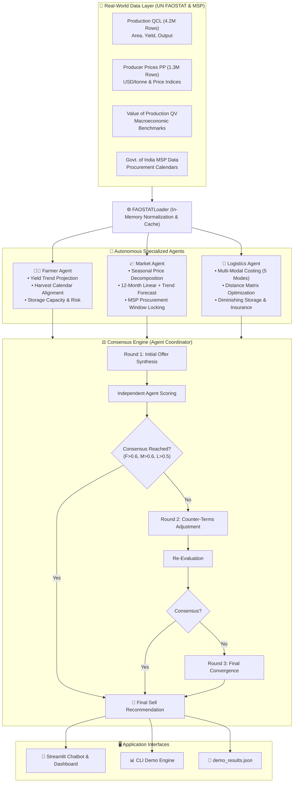

# 🌾 Multi-Agent Crop Sell Simulation System

<p align="center">
  
  
  
  
  
  
  
</p>

<p align="center">
  <strong>An autonomous, cooperative multi-agent decision support framework optimizing the timing, pricing, and destination for agricultural commodity sales.</strong><br>
  Powered by real UN FAOSTAT datasets, Indian Minimum Support Price (MSP) policy modeling, and automated multi-round consensus negotiation.
</p>

---

## 📌 Table of Contents

- [Overview](#-overview)
- [System Architecture](#-system-architecture)
- [How It Works: 3-Round Negotiation](#-how-it-works-3-round-negotiation)
- [Key Features](#-key-features)
- [Quick Start](#-quick-start)
  - [Prerequisites](#prerequisites)
  - [Installation](#installation)
  - [Dataset Acquisition](#faostat-dataset-setup)
- [Running the System](#-running-the-system)
  - [1. Interactive Web Chatbot UI](#1-interactive-web-chatbot-ui)
  - [2. CLI Demonstration Script](#2-cli-demonstration-script)
  - [3. Python API Integration](#3-python-api-integration)
- [Case Study & Benchmark (India 2024)](#-case-study--benchmark-india-2024)
- [Mathematical & Economic Models](#-mathematical--economic-models)
- [Project Directory Structure](#-project-directory-structure)
- [Running Validation Tests](#-running-validation-tests)
- [Deliverables & Reports](#-deliverables--reports)
- [Roadmap](#-roadmap)
- [Author & Acknowledgments](#-author--acknowledgments)

---

## 🌟 Overview

Agricultural producers face a multi-dimensional optimization challenge after every harvest season:
1. **The Harvest Glut Trap**: Selling immediately floods the market, collapsing spot mandi prices.
2. **Holding & Storage Risks**: Storing grain captures off-season price recovery, but incurs warehouse rents, spoilage risks, and capital lockup.
3. **Logistics Friction**: Multi-modal freight (truck, rail, ocean, container) varies wildly by distance and route efficiency.

Traditional agricultural advisory tools typically isolate price forecasting from transport logistics and farm-level cash flow needs. 

The **Multi-Agent Crop Sell Simulation System** solves this by modeling agricultural commerce as a cooperative negotiation between three autonomous agents—**Farmer**, **Market**, and **Logistics**—overseen by an **Agent Coordinator** that balances production constraints, seasonal price dynamics, and multi-modal freight costs to deliver an explainable, risk-adjusted sell strategy.

---

## 🏗️ System Architecture



---

## 🤝 How It Works: 3-Round Negotiation

| Step | Responsible | Action Description |
|:---:|:---:|:---|
| **1. Proposal Generation** | Coordinator | Extracts Farmer's volume, Market's optimal price peak, and Logistics' lowest-cost route to form a candidate plan: `[Target Month, Market Region, Price, Volume]`. |
| **2. Multi-Agent Evaluation** | All Agents | Each agent evaluates the plan against its domain constraints and returns a normalized score $[0.0, 1.0]$, acceptance boolean, qualitative reasoning, and counter-terms. |
| **3. Counter-Offer Adjustment** | Coordinator | If any agent rejects, the lowest-scoring agent's counter-terms (e.g., storage capacity limits or closer domestic mandi) are integrated into a revised proposal. |
| **4. Consensus & Traceability** | Coordinator | Once thresholds are satisfied (or after Round 3), generates a `SellRecommendation` with a quantified confidence score and complete audit trail. |

---

## ⚡ Key Features

- **Authoritative Data Integration**: Ingests normalized UN FAOSTAT bulk datasets spanning 244 countries, 301 commodities, and years 1961–2024.
- **Crop & Country Coverage**: 6 core agricultural crops (*Wheat, Maize, Rice Paddy, Soybeans, Barley, Sorghum*) across 11 major producing economies with deep India-specific calibration.
- **Hemisphere-Aware Harvest Schedules**: Embedded calendars accounting for Northern/Southern hemisphere harvest wraps (e.g., Australia/Argentina wheat in Nov–Jan vs. India rabi wheat in Mar–Apr).
- **Government MSP Price Floors**: Direct modeling of Indian Minimum Support Price (MSP) operations and procurement windows (e.g., FCI wheat procurement in April–June).
- **Multi-Modal Supply Chain Costing**: Dynamic rates and fixed fees across 5 transport modes:
  - 🚛 **Truck**: Short-haul domestic transport (\$0.08/tonne-km)
  - 🚆 **Rail**: Bulk inland long-haul (\$0.04/tonne-km)
  - 🚢 **Barge**: Inland waterways (\$0.025/tonne-km)
  - 🌊 **Ocean Vessel**: Transoceanic bulk (\$0.015/tonne-km)
  - 📦 **Container**: High-value/export intermodal (\$0.03/tonne-km)
- **Natural Language Chatbot UI**: Interactive Streamlit interface supporting English and Hindi farming queries with automated parameter extraction.

---

## 🚀 Quick Start

### Prerequisites

- **Python**: `3.11` or higher recommended
- **Operating System**: Windows, macOS, or Linux
- **RAM**: 8 GB+ recommended (for parsing FAOSTAT bulk archives)

### Installation

```bash
# 1. Clone the repository
git clone https://github.com/piyushrawat/crop-sell-simulation.git
cd crop-sell-simulation

# 2. Create and activate a virtual environment
# Windows:
python -m venv .venv
.venv\Scripts\activate

# Linux / macOS:
python3 -m venv .venv
source .venv/bin/activate

# 3. Install dependencies
pip install -r requirements.txt
```

### FAOSTAT Dataset Setup

Download the official FAOSTAT bulk archives (ZIP format) from the [FAOSTAT Data Portal](https://www.fao.org/faostat/en/#data) and place them in the `data/` directory:

| Dataset | FAOSTAT Portal Section | File Name in `data/` |
|---|---|---|
| **Production** | Production > Crops and Livestock Products | `production_crops_livestock.zip` |
| **Producer Prices** | Prices > Producer Prices | `producer_prices.zip` |
| **Value of Production** | Production > Value of Production | `value_of_production.zip` |

Verify directory structure:
```text
crop-sell-simulation/
├── data/
│   ├── production_crops_livestock.zip
│   ├── producer_prices.zip
│   └── value_of_production.zip
```

---

## 💻 Running the System

### 1. Interactive Web Chatbot UI

Launch the Streamlit web dashboard for farmers and agricultural advisors:

```bash
streamlit run chatbot_ui.py
```

- **Natural Language Parsing**: Type queries such as *"When should I sell wheat in Punjab?"* or *"Best market for 500 ha of rice in India?"*
- **Parameter Sliders**: Adjust farm area, crop variety, country, and risk profile on the fly.
- **Multi-Tab Diagnostics**: Inspect price forecasts, logistics breakdowns, and negotiation transcripts.

### 2. CLI Demonstration Script

Run the automated 3-scenario India evaluation (Wheat, Rice, Maize):

```bash
python demo.py
```

*Outputs formatted recommendations, agent reasoning traces, alternative window comparisons, and writes full structured output to `demo_results.json`.*

### 3. Python API Integration

Embed the simulation directly into your data pipelines:

```python
from src.simulation.orchestrator import run_simulation

# Execute optimization
recommendation = run_simulation(
    crop="wheat",        # 'wheat', 'rice_paddy', 'maize', 'soybeans', 'barley', 'sorghum'
    country="india",     # 'india', 'usa', 'brazil', 'china', etc.
    year=2024,
    farm_size=1000.0,    # Farm area in hectares
    data_dir="data"
)

# Access decision metrics
print(f"Recommended Sell Month : {recommendation.recommended_sell_month}")
print(f"Optimal Market Route   : {recommendation.recommended_market.value}")
print(f"Expected Gross Price   : ${recommendation.expected_price_usd_per_tonne:.2f}/t")
print(f"Logistics & Holding    : ${recommendation.logistics_cost_per_tonne:.2f}/t")
print(f"Net Realized Price     : ${recommendation.net_price_usd_per_tonne:.2f}/t")
print(f"Net Farm Profit        : ${recommendation.net_profit_usd:,.2f}")
print(f"System Confidence      : {recommendation.confidence_score:.0%}")

# Access agent reasoning audit trail
for agent, trace in recommendation.reasoning_trace.items():
    print(f"[{agent.upper()}]: {trace}")
```

---

## 📊 Case Study & Benchmark (India 2024)

Empirical execution across three representative Indian cropping systems (1,000 ha baseline, moderate risk):

| Commodity | Season | Recommended Window | Target Market | Expected Gross | Logistics Cost | Net Realized Price | Net Farm Profit | Consensus Confidence |
|:---|:---|:---:|:---:|:---:|:---:|:---:|:---:|:---:|
| **Wheat** | Rabi | **June (Month 6)** | Domestic (Rail) | \$460.13 / t | \$58.94 / t | **\$401.19 / t** (₹33,298/t) | **\$43.6M** (~₹362 Cr) | **80%** |
| **Rice Paddy** | Kharif | **Dec (Month 12)** | Domestic (Rail) | \$426.35 / t | \$89.29 / t | **\$337.06 / t** (₹27,975/t) | **\$65.7M** (~₹545 Cr) | **72%** |
| **Maize** | Kharif/Rabi | **Dec (Month 12)** | Domestic (Rail) | \$329.99 / t | \$56.38 / t | **\$273.61 / t** (₹22,709/t) | **\$9.2M** (~₹76 Cr) | **80%** |

*All results verified via `demo.py` and serialized to `demo_results.json`.*

---

## 📐 Mathematical & Economic Models

### 1. Yield & Production Estimation
Yield projection uses a 5-year moving average with uncertainty weighted by historical Coefficient of Variation ($CV$):

$$\hat{Y} = \frac{1}{K}\sum_{i=1}^{K} Y_{t-i}, \quad \text{Confidence}_{\text{Farmer}} = \max\left(0.3, \min\left(0.9, 1 - \frac{\sigma_Y}{\bar{Y}}\right)\right)$$

### 2. Seasonal Price Forecasting & MSP Floor
Annual prices are modeled via linear trend regression adjusted by seasonal multipliers $S_m$ derived from harvest cycles:

$$\hat{P}_m = \left(\beta_0 + \beta_1 \cdot t_m\right) \times S_m$$

For Indian commodities during government procurement months $m \in \mathcal{M}_{\text{MSP}}$:

$$P_m^* = \max\left(\hat{P}_m, P_{\text{MSP}}\right)$$

### 3. Total Supply Chain Logistics Cost
Total logistics cost per tonne accounts for fixed terminal costs, distance-based variable freight, diminishing storage rates, and cargo insurance:

$$C_{\text{total}} = C_{\text{transport}}(d) + C_{\text{storage}}(m_s) + C_{\text{handling}} + C_{\text{insurance}}$$

Where storage cost $C_{\text{storage}}$ incorporates diminishing marginal cost for bulk warehouse tenures:

$$C_{\text{storage}}(m_s) = \begin{cases} 
r \cdot m_s & m_s \le 3 \\
3r + 0.9r(m_s - 3) & 3 < m_s \le 6 \\
3r + 2.7r + 0.8r(m_s - 6) & m_s > 6
\end{cases}$$

---

## 📁 Project Directory Structure

```text
crop-sell-simulation/
├── .gitignore                          # Standard gitignore (caches, venv, data ZIPs)
├── requirements.txt                    # Project dependencies (pandas, scipy, streamlit, pptx, docx)
├── README.md                           # Project documentation (this file)
├── chatbot_ui.py                       # Streamlit conversational web interface
├── demo.py                             # Runnable CLI demonstration script
├── demo_results.json                   # Output results of latest demo run
├── create_presentation.py              # Script to generate executive slide deck
├── generate_report_final.py            # PDF/DOCX technical report generator
├── Presentation.pptx                   # 9-slide executive PowerPoint presentation
├── Project_Report.pdf                  # 25-page comprehensive academic/technical report
├── Project_Report.docx                 # Microsoft Word version of project report
├── SAMPLE_SELL_PLAN.md                 # Professional sample advisory sell plan (Wheat/India)
├── SPIKE_PLAN.md                       # Development & engineering spike plan
├── Annexure_Invention_Disclosure.docx  # Completed intellectual property disclosure document
├── data/                               # FAOSTAT data directory (ZIP files)
│   ├── production_crops_livestock.zip
│   ├── producer_prices.zip
│   └── value_of_production.zip
├── scripts/
│   └── validate_simulation.py          # Regression & test suite
└── src/
    ├── __init__.py                     # Package initialization & exports
    ├── agents/
    │   ├── __init__.py
    │   ├── base.py                     # BaseAgent, AgentCoordinator, message protocol
    │   ├── farmer.py                   # FarmerAgent (yield, calendars, storage capacity)
    │   ├── market.py                   # MarketAgent (price trends, seasonality, MSP)
    │   ├── logistics.py                # LogisticsAgent (multi-modal routing, storage model)
    │   └── models.py                   # Dataclasses, Enums, Harvest Calendars
    ├── data/
    │   ├── __init__.py
    │   └── faostat_loader.py           # FAOSTAT ZIP parser with caching & filtering
    └── simulation/
        ├── __init__.py
        └── orchestrator.py             # CropSellSimulation runner & consensus synthesis
```

---

## 🧪 Running Validation Tests

A dedicated test suite validates data ingestion, multi-agent convergence, and structure integrity across scenarios:

```bash
python scripts/validate_simulation.py
```

Expected output:
```text
PASS: wheat/usa
PASS: maize/brazil
PASS: soybeans/argentina
PASS: rice/india
PASS: structure validation
All validation tests passed!
```

---

## 📄 Deliverables & Reports

This repository includes a complete suite of academic and industry-ready documentation:

| Document | Format | Description |
|---|---|---|
| **[Project_Report.pdf](file:///d:/projects/crop-sell-simulation/Project_Report.pdf)** | PDF (25 pages) | Comprehensive technical report detailing architecture, methodology, validation, and risk analysis. |
| **[Project_Report.docx](file:///d:/projects/crop-sell-simulation/Project_Report.docx)** | Word DOCX | Editable document version of the technical report. |
| **[Presentation.pptx](file:///d:/projects/crop-sell-simulation/Presentation.pptx)** | PowerPoint (16:9) | 9-slide executive deck covering problem statement, MAS architecture, and case study outcomes. |
| **[SAMPLE_SELL_PLAN.md](file:///d:/projects/crop-sell-simulation/SAMPLE_SELL_PLAN.md)** | Markdown | Executive-level sell plan for wheat in Punjab/Haryana with mandi routing and MSP coordination. |
| **[Annexure_Invention_Disclosure.docx](file:///d:/projects/crop-sell-simulation/Annexure_Invention_Disclosure.docx)** | Word DOCX | Official Invention Disclosure Form (IDF) for intellectual property registration. |

---

## 🗺️ Roadmap

- [x] Three-agent cooperative negotiation framework (Farmer, Market, Logistics)
- [x] Ingestion of 6.3M+ records from UN FAOSTAT Production, Prices, and Value datasets
- [x] Indian Minimum Support Price (MSP) policy modeling & seasonal calendar wrap handling
- [x] Interactive Streamlit chatbot UI with dual English/Hindi keyword parsing
- [x] High-precision logistics cost & diminishing-rate storage modeling
- [ ] **Live e-NAM API Integration**: Ingest real-time daily mandi spot prices across Indian states
- [ ] **Climate & Satellite Analytics**: Integrate Copernicus & IMD precipitation indices for pre-harvest yield shocks
- [ ] **Stochastic Nash Bargaining**: Incorporate game-theoretic bargaining games alongside heuristic scoring
- [ ] **Multi-Crop Portfolio Optimization**: Simultaneous cash-flow balancing across multi-crop agricultural holdings

---

## 👨‍💻 Author & Acknowledgments

**Piyush Rawat**  
*Autonomous Software Development & AI/ML Project Engineer*  
School of Computer Science and Engineering, Lovely Professional University, Punjab, India  

### Data Attribution
- Data courtesy of the **Food and Agriculture Organization of the United Nations (UN FAO)** — [FAOSTAT Statistical Database](https://www.fao.org/faostat/).
- Indian agricultural pricing benchmarks derived from the **Commission for Agricultural Costs and Prices (CACP)**, Ministry of Agriculture & Farmers Welfare, Government of India.

---

<p align="center">
  <sub>Released for research, agricultural development, and demonstration purposes.</sub>
</p>
